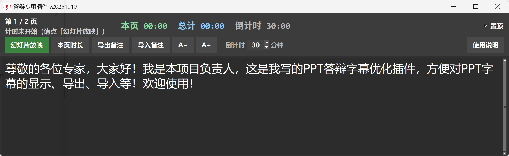

# PPT答辩备注优化插件

Windows 下的 PowerPoint 答辩/录屏辅助工具：放映时置顶显示当前页备注，并提供排练计时与备注导出。

> 不是 Office 官方加载项，而是通过 COM 连接桌面版 PowerPoint 的独立小工具。



## 功能

- 放映时浮动显示**当前页备注**（事件驱动 + 高频兜底，尽量实时）
- **幻灯片放映**按钮：点了才开始本页/总计时与倒计时
- 按钮行可设置**倒计时**（分钟，写入 `config.json`），剩余时间以灰色显示在顶部「总计」右侧，最后 1 分钟变红
- 放映结束后弹出**各页累计时长**（可导出 CSV；也可点「本页时长」重开）
- **置顶**、**背景透明**开关（背景透明默认勾选）、字号放大缩小（`A+` / `A−` 或 `Ctrl+滚轮`）
- 窗口可拖拽改大小
- **逐页导出备注为 Word（.docx）**，英文 Times New Roman、中文宋体；备注中 `#…#` 导出为批注且不计入字数
- **从 Word 导入备注**：选择同格式的 Word，按「第 N 页」标题覆盖对应页备注，批注用 `#…#` 包裹、空一行放在该页备注最后；写入后需在 PowerPoint 中保存
- **清除备注**：可清除当前页或全部页备注（清除前确认）；完成后需在 PowerPoint 中保存
- 翻页使用 PowerPoint 原生快捷键（`→` / `←` / 空格等）

## 环境要求

- Windows 10 / 11
- 桌面版 Microsoft PowerPoint
- Python 3.10+（建议 3.11+）

## 快速开始

```bat
pip install -r requirements.txt
python notes_overlay.py
```

或双击 `scripts\run.bat`。

使用步骤：

1. 先打开带备注的 PPT
2. 运行本工具
3. 点工具里的「幻灯片放映」开始放映并计时
4. 浮动窗会同步显示当前页备注与计时

录制时建议只录制/共享幻灯片窗口，避免把备注浮窗一起录进去。

## 配置

同目录下 `config.json` 可改工具名称和默认倒计时（倒计时在界面上修改后也会写回这里）：

```json
{
  "app_title": "PPT答辩备注优化插件",
  "countdown_min": 30
}
```

- 开发运行：改源码目录里的 `config.json`
- 打包 exe：分发时只需发 exe；首次运行会在 exe 同目录自动生成 `config.json`，该目录不可写时改存到 `%APPDATA%\PPT答辩备注优化插件\config.json`

## 打包成 exe

实际打包逻辑在 `scripts/build_exe.py`（避免 bat 编码问题）。任选其一：

```bat
scripts\build_exe.bat
```

```powershell
powershell -ExecutionPolicy Bypass -File scripts\build_exe.ps1
```

```bat
python scripts\build_exe.py
```

产物：`dist\PPT答辩备注优化插件_vYYYYMMDD.exe`。版本号为 v + 8 位日期，打包时自动写入 `notes_overlay.py` 的 `APP_VERSION`，窗口标题、右下角标签和 exe 文件名同步显示。

## 目录结构

```text
ppt-notes-overlay/
├── notes_overlay.py      # 主程序
├── config.json           # 可配置名称等
├── assets/
│   ├── icon.ico          # 应用图标
│   ├── icon.png
│   └── screenshot.png    # README 界面截图
├── scripts/
│   ├── run.bat           # 开发运行
│   └── build_exe.bat     # 打包 exe
├── requirements.txt
├── requirements-dev.txt
├── LICENSE
└── README.md
```

## 说明与免责

- `assets/icon.*` 默认图标如使用校徽/商标，请在公开发布前确认授权，或自行替换。
- 本工具按 MIT 协议开源，不提供任何担保；答辩/录屏请自行做好备份与演练。

## License

MIT
